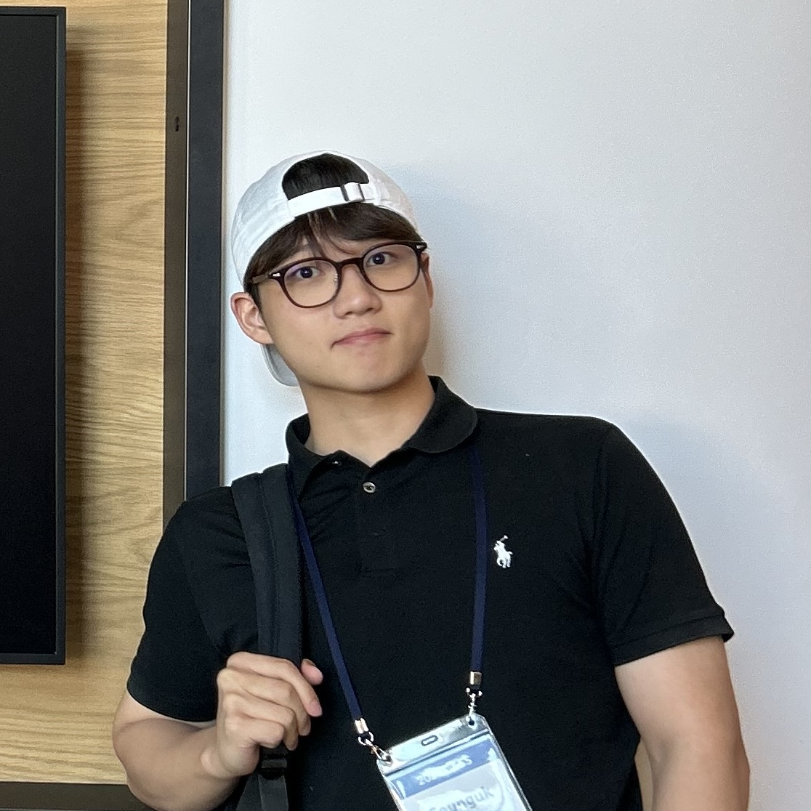
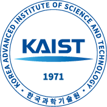
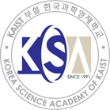

```{=html}
<div class="sk-about-page">
  <div class="sk-mobile-notice">
    This page is optimized for desktop viewing. Please use a larger screen for the best layout.
  </div>

  <div class="sk-about-hero">
    <div class="sk-profile-panel">
      
      <h1 class="sk-profile-name">Seunguk Kang</h1>
      <p class="sk-profile-role">Researcher · AI &amp; Computational Chemistry</p>
      <div class="sk-profile-divider" aria-hidden="true"></div>
      <div class="sk-social-links">
        <a class="sk-scholar-link" href="https://scholar.google.com/citations?user=_5y9eGkAAAAJ" target="_blank" rel="noopener" aria-label="Google Scholar profile">
          <i class="bi bi-mortarboard" aria-hidden="true"></i>
          Google Scholar
        </a>
        <a href="https://github.com/seungukkang" target="_blank" rel="noopener" aria-label="GitHub profile">
          <i class="bi bi-github" aria-hidden="true"></i>
          GitHub
        </a>
        <a href="https://www.linkedin.com/in/seungukkang319/" target="_blank" rel="noopener" aria-label="LinkedIn profile">
          <i class="bi bi-linkedin" aria-hidden="true"></i>
          LinkedIn
        </a>
        <a href="mailto:drkd319@kaist.ac.kr" aria-label="Email Seunguk Kang">
          <i class="bi bi-envelope" aria-hidden="true"></i>
          Email
        </a>
        <a href="assets/cv/Seunguk_Kang_CV.pdf" target="_blank" rel="noopener" aria-label="Download CV">
          <i class="bi bi-file-earmark-text" aria-hidden="true"></i>
          CV
        </a>
      </div>
    </div>
    <div class="sk-about-copy">
      <p class="sk-about-intro">
        I’m an undergraduate chemistry student at KAIST, conducting research in <a class="sk-lab-link" href="https://wooyoun.kaist.ac.kr/" target="_blank" rel="noopener noreferrer">Prof. Woo Youn Kim’s group<span class="sk-link-icon" aria-hidden="true"></span><span class="visually-hidden"> website</span></a>. My current work combines molecular generative modeling with nonequilibrium statistical mechanics to estimate free-energy differences for molecular conformational ensembles.
      </p>
      <p class="sk-about-intro">
        My research experience spans experimental materials chemistry, computational reaction mechanisms, and molecular machine learning. Across these areas, I’m interested in how molecular structure, local environments, and physical constraints shape chemical behavior.
      </p>
      <p class="sk-about-intro">
        In the long term, I hope to apply these approaches to biological problems, including the molecular mechanisms of Alzheimer’s disease and the dynamics of intrinsically disordered proteins.
      </p>
    </div>
  </div>

  <section class="sk-about-section" id="education">
    <h2>Education</h2>
    <div class="sk-entry-list">
      <article class="sk-entry">
        <div class="sk-entry-mark">
          
        </div>
        <div class="sk-entry-body">
          <div class="sk-entry-header">
            <div>
              <h3>Korea Advanced Institute of Science and Technology (KAIST)</h3>
              <p class="sk-entry-role"><em>Bachelor of Science - Chemistry</em></p>
              <p class="sk-entry-advisor">Expected graduation: February 2028</p>
            </div>
            <div class="sk-entry-meta">
              <span>Daejeon, Republic of Korea</span>
              <span>2022 - Present</span>
            </div>
          </div>
        </div>
      </article>

      <article class="sk-entry">
        <div class="sk-entry-mark">
          
        </div>
        <div class="sk-entry-body">
          <div class="sk-entry-header">
            <div>
              <h3>Korea Science Academy (KSA)</h3>
              <p class="sk-entry-role"><em>High School Diploma - Chemistry</em></p>
            </div>
            <div class="sk-entry-meta">
              <span>Busan, Republic of Korea</span>
              <span>2019 - 2021</span>
            </div>
          </div>
        </div>
      </article>
    </div>
  </section>

  <section class="sk-about-section" id="research-experiences">
    <h2>Research Experience</h2>
    <div class="sk-entry-list">
      <article class="sk-entry sk-entry-plain">
        <div class="sk-entry-body">
          <div class="sk-entry-header">
            <div>
              <h3><a class="sk-lab-link" href="https://wooyoun.kaist.ac.kr/" target="_blank" rel="noopener noreferrer">Intelligent Chemistry Lab<span class="sk-link-icon" aria-hidden="true"></span><span class="visually-hidden"> website</span></a> <span class="sk-entry-separator">&middot;</span> KAIST</h3>
              <p class="sk-entry-role">Undergraduate Researcher</p>
              <p class="sk-entry-advisor">Advisor: Prof. Woo Youn Kim</p>
            </div>
            <div class="sk-entry-meta">
              <span>Dec. 2025 - Present</span>
            </div>
          </div>
          <h4 class="sk-entry-subheading">Neural Free-Energy Estimation for Molecular Ensembles</h4>
          <ul class="sk-entry-bullets">
            <li>Developing a free-energy estimation framework that uses a stochastic-interpolant model to propose transport paths between a harmonic reference and molecular Boltzmann distributions, with free-energy differences estimated from endpoint densities and forward–reverse path probabilities using Bennett acceptance ratio (BAR).</li>
            <li>Adapted and retrained DiTMC for Boltzmann-weighted ensemble generation and built the main inference pipeline, including transport kernels, work calculations, reverse-start sampling, BAR estimation, and diagnostic analyses.</li>
          </ul>
          <h4 class="sk-entry-subheading">Full-Atom Antibody Design with Antigen Flexibility</h4>
          <ul class="sk-entry-bullets">
            <li>Investigated full-atom antibody design accounting for antigen flexibility and induced fit with an E(3)-equivariant generative framework.</li>
            <li>Designed and implemented auxiliary losses for atomic clashes and backbone and side-chain geometry, accounting for valid disulfide bonds; developed visualization and validation tools to assess structural accuracy and physical plausibility.</li>
          </ul>
          <h4 class="sk-entry-subheading">AD-Agent: Mechanism-Aware Drug Repurposing for Alzheimer’s Disease</h4>
          <ul class="sk-entry-bullets">
            <li>Investigated mechanism-guided drug repurposing for Alzheimer’s disease using multi-agent reasoning.</li>
            <li>Implemented OpenTargets retrieval functions to integrate mechanistic and clinical evidence with traceable sources.</li>
          </ul>
        </div>
      </article>

      <article class="sk-entry sk-entry-plain">
        <div class="sk-entry-body">
          <div class="sk-entry-header">
            <div>
              <h3><a class="sk-lab-link" href="https://baik-laboratory.com/" target="_blank" rel="noopener noreferrer">Baik Group<span class="sk-link-icon" aria-hidden="true"></span><span class="visually-hidden"> website</span></a> <span class="sk-entry-separator">&middot;</span> KAIST</h3>
              <p class="sk-entry-role">Undergraduate Researcher</p>
              <p class="sk-entry-advisor">Advisor: Prof. Mu-Hyun Baik</p>
            </div>
            <div class="sk-entry-meta">
              <span>Jan. 2024 - Dec. 2025</span>
            </div>
          </div>
          <h4 class="sk-entry-subheading">Brønsted Acid-Assisted Solid-State [2+2] Photocycloaddition</h4>
          <p class="sk-entry-advisor">Collaboration: Prof. Tehshik P. Yoon, University of Wisconsin–Madison</p>
          <ul class="sk-entry-bullets">
            <li>Investigated how the local molecular environment and water influence selectivity and reactivity using DFT, molecular dynamics, and QM/MM calculations.</li>
            <li>Applied explicit-environment modeling to reproduce the observed diastereoselectivity that conventional DFT solvation models could not capture. <a href="#photocycloaddition-manuscript">Manuscript in preparation.</a></li>
          </ul>
          <h4 class="sk-entry-subheading">Enantioselective Olefin 1,2-Arylamination with Chiral Indenyl–Rh Catalysts</h4>
          <p class="sk-entry-advisor">Collaboration: Prof. Simon B. Blakey, Emory University</p>
          <ul class="sk-entry-bullets">
            <li>Investigated indenyl effects and how N-protecting groups modulate nitrogen nucleophilicity and chemoselectivity between arylamination and aziridination using DFT calculations.</li>
            <li>Proposed additional ligand controls, including saturated indenyl derivatives, to test the model of asymmetric orbital interactions underlying the indenyl effect. <a href="#arylamination-publication">Published in ACS Catalysis (2026).</a></li>
          </ul>
        </div>
      </article>

      <article class="sk-entry sk-entry-plain">
        <div class="sk-entry-body">
          <div class="sk-entry-header">
            <div>
              <h3><a class="sk-lab-link" href="https://yoon.kaist.ac.kr/" target="_blank" rel="noopener noreferrer">Soft Material Assembly Group<span class="sk-link-icon" aria-hidden="true"></span><span class="visually-hidden"> website</span></a> <span class="sk-entry-separator">&middot;</span> KAIST</h3>
              <p class="sk-entry-role">Undergraduate Researcher</p>
              <p class="sk-entry-advisor">Advisor: Prof. Dong Ki Yoon</p>
            </div>
            <div class="sk-entry-meta">
              <span>Jun. 2023 - Dec. 2023</span>
            </div>
          </div>
          <h4 class="sk-entry-subheading">Tunable Electrical Conductance Anisotropy in MOF–Polymer Composites</h4>
          <ul class="sk-entry-bullets">
            <li>Synthesized oxidation-sensitive Cu<sub>3</sub>(HHTP)<sub>2</sub> and its derivatives, maintaining material quality and consistency for conductive MOF–polymer composites.</li>
            <li>Optimized voltage conditions for electric-field alignment of MOFs in a polymer matrix while avoiding solvent evaporation and material shortage in the ITO film. <a href="#mof-publication">Published in Small (2024); featured on the front cover.</a></li>
            <li>Also investigated MOF–polymer composites as selective gas sensors.</li>
          </ul>
        </div>
      </article>

      <article class="sk-entry sk-entry-plain">
        <div class="sk-entry-body">
          <div class="sk-entry-header">
            <div>
              <h3>Choi Group <span class="sk-entry-separator">&middot;</span> KSA</h3>
              <p class="sk-entry-role">Student Researcher</p>
              <p class="sk-entry-advisor">Advisor: Prof. Eun Young Choi</p>
            </div>
            <div class="sk-entry-meta">
              <span>Apr. 2019 - Dec. 2021</span>
            </div>
          </div>
          <h4 class="sk-entry-subheading">Activation and Adsorption Studies of MOFs and Zeolites</h4>
          <ul class="sk-entry-bullets">
            <li>Performed gas and ion exchange experiments on zeolite single crystals under high-vacuum conditions.</li>
            <li>Developed mild activation protocols for fragile porphyrin-based metal-organic frameworks to improve gas adsorption.</li>
          </ul>
          <h4 class="sk-entry-subheading">Biocompatible Metal–Tartrate MOFs and Their Antibacterial Properties</h4>
          <p class="sk-entry-advisor">Singapore International Collaborative Research Program · Team Leader</p>
          <ul class="sk-entry-bullets">
            <li>Synthesized Zn-, Co-, and Ag-tartrate MOFs through rapid room-temperature self-assembly and investigated their antibacterial properties.</li>
          </ul>
        </div>
      </article>
    </div>
  </section>

  <section class="sk-about-section" id="publications">
    <h2>Publications &amp; Manuscripts</h2>
    <div class="sk-publication-list">
      <article class="sk-publication" id="photocycloaddition-manuscript">
        <div>
          <div class="sk-publication-kicker">
            <span class="sk-publication-number">[J3]</span>
            <span class="sk-pub-type-badge pub-manuscript">Manuscript in preparation</span>
          </div>
          <p class="sk-publication-title">Mechanistic Origins of Selectivity in Brønsted Acid-Assisted Solid-State [2+2] Photocycloaddition.</p>
          <p class="sk-publication-authors">Choi, H.; <strong>Kang, S.</strong>; Baik, M.-H.</p>
        </div>
      </article>

      <article class="sk-publication" id="arylamination-publication">
        <div>
          <div class="sk-publication-kicker">
            <span class="sk-publication-number">[J2]</span>
            <span class="sk-pub-type-badge pub-journal">Journal</span>
          </div>
          <p class="sk-publication-title">Enantioselective Olefin 1,2-Arylamination Catalyzed by a Planar Chiral Indenyl-Rhodium(III) Complex.</p>
          <p class="sk-publication-authors">Gross, P.; Choi, H.; Pullara, W. A.; Im, H.; Ung, K.; <strong>Kang, S.</strong>; Baik, M.-H.; Blakey, S. B.</p>
          <p class="sk-publication-venue"><em>ACS Catal.</em> <strong>2026</strong>, 16(4), 3453-3463.</p>
          <div class="sk-publication-links">
            <a href="https://doi.org/10.1021/acscatal.5c07589" target="_blank" rel="noopener noreferrer">Link</a>
            <a href="https://pubs.acs.org/doi/pdf/10.1021/acscatal.5c07589" target="_blank" rel="noopener noreferrer">PDF</a>
          </div>
        </div>
      </article>

      <article class="sk-publication" id="mof-publication">
        <div>
          <div class="sk-publication-kicker">
            <span class="sk-publication-number">[J1]</span>
            <span class="sk-pub-type-badge pub-journal">Journal</span>
          </div>
          <p class="sk-publication-title">On-Demand Tunable Electrical Conductance Anisotropy in a MOF-Polymer Composite.</p>
          <p class="sk-publication-authors">Hong, T.; Lee, C.; Bak, Y.; Park, G.; Lee, H.; <strong>Kang, S.</strong>; Bae, T.-H.; Yoon, D. K.; Park, J. G.</p>
          <p class="sk-publication-venue"><em>Small</em> <strong>2024</strong>, 20(18), 2309469.</p>
          <p class="sk-publication-venue"><em>Featured on the front cover.</em></p>
          <div class="sk-publication-links">
            <a href="https://doi.org/10.1002/smll.202309469" target="_blank" rel="noopener noreferrer">Link</a>
            <a href="https://onlinelibrary.wiley.com/doi/pdf/10.1002/smll.202309469" target="_blank" rel="noopener noreferrer">PDF</a>
          </div>
        </div>
      </article>
    </div>
  </section>

  <section class="sk-about-section" id="selected-presentations">
    <h2>Selected Presentations</h2>
    <div class="sk-activity-list">
      <article class="sk-activity">
        <div>
          <h3>Spring Conference of the Korean Chemical Society <span class="sk-type-badge type-poster">Poster</span></h3>
          <p>Chiral Indenyl Rh-Catalyzed Enantioselective Olefin 1,2-Arylamination</p>
        </div>
        <div class="sk-activity-meta">
          <span>2025</span>
        </div>
      </article>

      <article class="sk-activity">
        <div>
          <h3>Research Presentation for Chemistry Department Workshop <span class="sk-type-badge type-oral">Oral</span></h3>
          <p>Chiral Indenyl Rh-Catalyzed Enantioselective Olefin 1,2-Arylamination</p>
        </div>
        <div class="sk-activity-meta">
          <span>2024</span>
        </div>
      </article>

      <article class="sk-activity">
        <div>
          <h3>Future Chemists Research Conference of the Korean Chemical Society <span class="sk-type-badge type-poster">Poster</span></h3>
          <p>Biocompatible MOFs Developed by Facile Ultra-Fast Room Temperature Synthesis</p>
        </div>
        <div class="sk-activity-meta">
          <span>2021</span>
        </div>
      </article>

      <article class="sk-activity">
        <div>
          <h3>Thailand International Science Fair <span class="sk-type-badge type-oral">Oral</span></h3>
          <p>Improvement of Gas Adsorption Efficiency of Fragile Porphyrin-based MOFs</p>
        </div>
        <div class="sk-activity-meta">
          <span>2021</span>
        </div>
      </article>

      <article class="sk-activity">
        <div>
          <h3>Autumn Conference of the Korean Polymer Society <span class="sk-type-badge type-poster">Poster</span></h3>
          <p>Improvement of Gas Adsorption Efficiency of Fragile Porphyrin-based MOFs</p>
        </div>
        <div class="sk-activity-meta">
          <span>2020</span>
        </div>
      </article>

      <article class="sk-activity">
        <div>
          <h3>Japan Super Science Fair <span class="sk-type-badge type-oral">Oral</span></h3>
          <p>Optimizing Synthesis Conditions of PPF-4: Effect of Acid Addition on Crystal Growth</p>
        </div>
        <div class="sk-activity-meta">
          <span>2020</span>
        </div>
      </article>
    </div>
  </section>

  <section class="sk-about-section" id="honors-and-awards">
    <h2>Honors and Awards</h2>
    <div class="sk-activity-list">
      <article class="sk-activity">
        <div>
          <h3>Best Participant Award</h3>
          <p>Global Entrepreneurship Summer School.</p>
        </div>
        <div class="sk-activity-meta">
          <span>2024</span>
        </div>
      </article>

      <article class="sk-activity">
        <div>
          <h3>2nd Prize</h3>
          <p>IR Pitching Contest, Global Entrepreneurship Summer School.</p>
        </div>
        <div class="sk-activity-meta">
          <span>2024</span>
        </div>
      </article>

      <article class="sk-activity">
        <div>
          <h3>Talent Award of Korea <span class="sk-award-badge">National Prize</span></h3>
          <p>Ministry of Education, Republic of Korea.</p>
          <p>Awarded by the Deputy Prime Minister and Minister of Education to 100 individuals nationwide who exemplify future leadership.</p>
        </div>
        <div class="sk-activity-meta">
          <span>2021</span>
        </div>
      </article>

      <article class="sk-activity">
        <div>
          <h3>Meritorious Service Award</h3>
          <p>Graduation of Korea Science Academy.</p>
        </div>
        <div class="sk-activity-meta">
          <span>2021</span>
        </div>
      </article>

      <article class="sk-activity">
        <div>
          <h3>Academic Excellence Award and Comprehensive Studies Award</h3>
          <p>Chemistry Department, Korea Science Academy. 1st and 2nd semesters.</p>
        </div>
        <div class="sk-activity-meta">
          <span>2020, 2021</span>
        </div>
      </article>

      <article class="sk-activity">
        <div>
          <h3>Gold Prize</h3>
          <p>World Invention Creativity Olympic (WICO), International Competition.</p>
        </div>
        <div class="sk-activity-meta">
          <span>2017</span>
        </div>
      </article>

      <article class="sk-activity">
        <div>
          <h3>The Minister's Award <span class="sk-award-badge">National Prize</span></h3>
          <p>Korean Youth Invention Idea Contest, Ministry of Science and ICT, Republic of Korea.</p>
        </div>
        <div class="sk-activity-meta">
          <span>2017</span>
        </div>
      </article>

      <article class="sk-activity">
        <div>
          <h3>Silver Prize</h3>
          <p>Youth Science Debate Competition, National Competition.</p>
        </div>
        <div class="sk-activity-meta">
          <span>2015</span>
        </div>
      </article>
    </div>
  </section>

  <section class="sk-about-section" id="extra-activities">
    <h2>Extra Activities</h2>
    <div class="sk-activity-list">
      <article class="sk-activity">
        <div>
          <h3>Team Leader (CEO)</h3>
          <p>Mock start-up, KAIST ENablers.</p>
        </div>
        <div class="sk-activity-meta">
          <span>2024</span>
        </div>
      </article>

      <article class="sk-activity">
        <div>
          <h3>Band Leader</h3>
          <p>KAIST undergraduate band, CarpeDiem.</p>
        </div>
        <div class="sk-activity-meta">
          <span>2022 - 2023</span>
        </div>
      </article>

      <article class="sk-activity">
        <div>
          <h3>Research Lead</h3>
          <p>Singapore International Cooperative Research Team.</p>
        </div>
        <div class="sk-activity-meta">
          <span>2021</span>
        </div>
      </article>

      <article class="sk-activity">
        <div>
          <h3>Band Leader</h3>
          <p>Korea Science Academy band, Loony.</p>
        </div>
        <div class="sk-activity-meta">
          <span>2019 - 2021</span>
        </div>
      </article>
    </div>
  </section>
</div>
```
